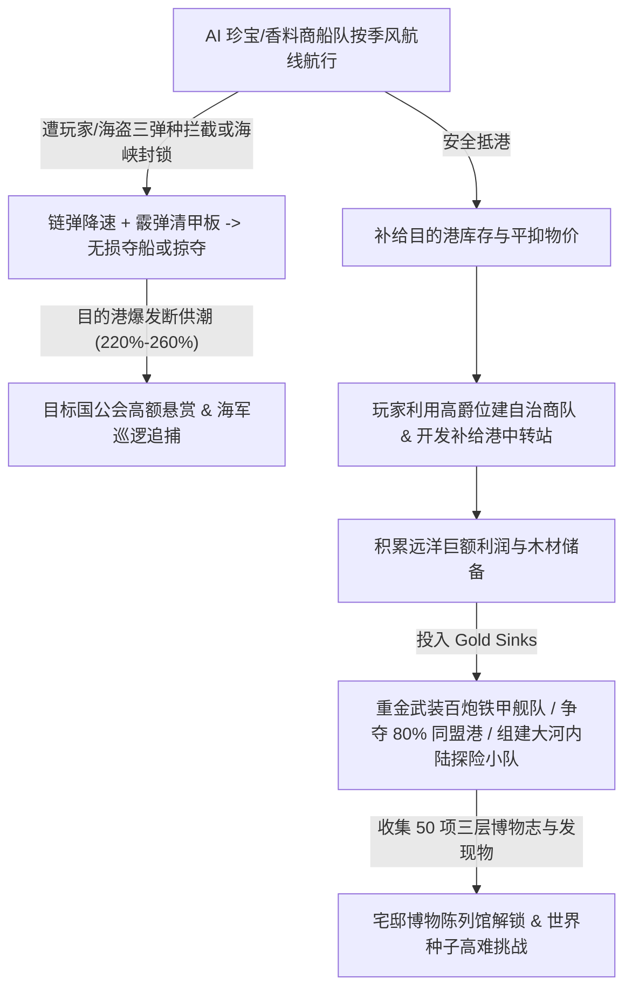

# 本项目现状差距审计与未来创新玩法总蓝图

**Status**: Architecture & Design Blueprint · **Date**: 2026-11-19 · **Layer**: `1-baseline`（对标原作与演进蓝图）

> 本文档承接 [主机版本评测与全机制参数圣经](console-versions-and-mechanics-bible.md)、[DECISIONS.md](../DECISIONS.md)（尤其是 **D1 叠加分层原则**、**D7 史实人文与去科幻原则**、**D16 模块化与存档演进原则**、**D20 SFC 音画重塑**）以及 [完整复刻蓝图与后续规划](../roadmap/full-remake-roadmap.md)，系统性盘点本仓库现有源码与原版 SFC/SS 机制之间的差距，并提出不破坏历史基线、面向未来的六大创新玩法与工程演进架构。

---

## 第 1 部分：原版机制 vs 本项目现有源码（`src/`）逐系统量化差距矩阵

本仓库当前已圆满收口 **Phase 1（M0–M4 六大主角全主线通关、SFC 美术/音效重塑 D20、港口核心建筑闭环）** 与 **`Save v7`** 迁移链路。但为了从“六线剧情可通关的复刻骨架”进化为“具备原版完整策略深度与重玩价值的航海沙盒”，必须先给当前源码做一个全景水位定位，再逐系统明确现有实现与原版之间的精确落差：

### 1.0 全景实现水位总评与“黄金起点”判断

如果以 **SFC / SS 原版完全体** 作为 `100%` 标尺，当前代码库的真实水位画像如下：

> **工程底座、六线主线完备度与视听表现已达到 `90%+`（在双语、像素/HD 昼夜光影与声明式架构上甚至局部超越原版）；但底层沙盒机制与数值深水区整体处于 `~30%–35%` 的「轻量化剧情通关 MVP」水位**——主线故事全通，而原版最核心的后期策略循环（海权争夺、六角海战夺船、深度造船改舱、98 发现物与 50 随机村落、90+ 航海士养成与叛逃）仍处于简化原型或待接线状态。

#### 八大模块还原水位百分比速览

| 核心模块 | 当前还原水位 | 一句话现状定位 |
| :--- | :---: | :--- |
| **工程底座、六线剧情与音画** | **90%+（局部超越）** | 六大主角 `147` 个声明式剧情事件全通、SFC 水彩立绘 + Web Audio 合成音效、HD 里斯本昼夜天气光影、中英双语即时切换、`Save v7` 迁移链完备。 |
| **世界地图、季风与单船航速** | **~70%** | `2160×1080` 环绕世界、`450` 格冬夏双季风向表与 6 类帆效都在；但只计算旗舰 `ships[0]` 速度、洋流仅作 HUD 指示尚未叠加进航行位移、无水手三岗分配且 `navigationLevel` 静态不成长。 |
| **贸易定价与市场波动** | **~45%** | 13 市场圈与单一参考价 `±10%` 涨跌 / 日惰性回归已做（彻底杜绝同港套利）；但仅 `24` 种商品（原版 `70+`），缺同品类 `2×` 冲击、无关税/免税证生效、无交涉砍价与投资翻旗子。 |
| **补给消耗与海上生存** | **~40%** | 有每日 `ceil(crew/10)` 水粮扣减与断粮 `10%/20%` 减员拖回港；但无配给率、无健康度、无 50 天坏血病/鼠患/暴风雨，应急道具（猫/鼠药/香膏/青柠汁）入包暂无触发逻辑，缺海岸免费取水。 |
| **造船厂与舰船装备** | **~35%** | 25 种船型与 11 地区工业解锁池齐全；但新船缺 7 种材质选择、改造缺“拆炮减员换货舱”容积滑块、无 7 种舰炮射程威力分化、无 10 阶船首像。 |
| **港口设施、银行与教会** | **~35%** | 10 类建筑可交互；但建筑不按营业时段打烊、占卜馆（`Building 12`）未实装、银行 `3%/10%` 月息仅在台词中提示未实际计息、教堂 `pray()` 为空函数且捐款还不加 `luck`。 |
| **探索发现、爵位与公会** | **~25%–30%** | 仅 `14` 个经纬度地标，且 `src/state/actionsDiscovery.ts` 中 `reportDiscoveries()` 当前硬编码限制仅可在里斯本公会（`portId === '1' && buildingId === '7'`）领赏；缺 98 发现物、50 随机村落与地图工房；王宫 `getRoyalRank()` 简化且缺 `400*r²` 敕命与公会四大随机委托。 |
| **海战、单挑与海上 AI 生态** | **~20%–25%** | `state.fleets` 仅玩家 `'1'` 队活跃（缺全球 AI 商船/海盗巡航）；海战为 1v1 四档距离文字战（不可夺船），单挑为独立血条 + 敌方 `(round-1)%3` 确定性出招。 |

#### 为什么说现在是复刻全部机制的“黄金起点”？

1. **静态数据底座已备齐大半**：`130` 港口坐标、6 国黑市免税证 `secret` 定位、`25` 船型面板、`71` 件道具、`450` 格冬夏风流二进表以及 `50` 项三层博物档案（`relicData.ts` / `legendData.ts` / `tradeGoodData.ts`）都已躺在 `src/data/` 中，许多机制只需“把算法引擎接上既有数据”。
2. **叙事引擎与底层沙盒彻底解耦**：六大主角主线全部在 `src/story/core/` 声明式运行，升级市场、造船、海战与探索不会改崩已验收入库的六条主线。
3. **存档迁移框架成熟**：`Save v1 → v7` 的逐版本无损升级管线（`src/state/saveMigrations.ts`）稳固可测，后续按 `Save v8 → v11` 分批补齐经典机制与创新玩法风险极低。

### 1.1 八大核心系统逐项对比表

| 系统域 | 原版 SFC/SS 完整机制（见参数圣经） | 本项目现行源码实现（实测盘点） | 核心缺失项与偏差 | 复刻优先级 |
| :--- | :--- | :--- | :--- | :---: |
| **1. 时间与港口设施** | 12 类建筑各自拥有严格营业时段（如交易所/船厂/公会/银行/王宫 `04:00–19:30`、道具店 `08:00–19:30` 与黑市 `02:00–02:30`、占卜馆 `16:00–23:30`）；每月 `1 日` 触发全局月度结算（发薪、计息、易帜、相場回归）。 | `src/state/actionsPort.ts` (`exitBuildingWithoutSave` 随机消耗 `40/60/80` 分钟，`checkIn` 睡至次日清晨)；`src/state/selectors.ts` (`isDay`: `04:00–20:00`，`secretItemShopOpen`: `02:00–03:00`)；`src/interface/port/Building.tsx` 中 `12`（占卜馆）与 `8`（杂项）仍为未实装提示。 | ① 各建筑尚未按营业时段强制打烊拦截；<br>② 占卜馆 (`Building 12`) 尚未实装；<br>③ 缺少每月 `1 日` 全局月度结算 Hook；<br>④ 黑市窗口当前宽容为 `02:00–03:00`（原版 `02:00–02:30`）。 | **P1** |
| **2. 航行物理与生存** | 舰队按**最慢船**统一移动；水手分**航海/瞭望/战斗**三岗；**配给率（Rations %）**与**健康度（Condition）**联动；**水粮资材共享、炮弹按单船独立**；连续航行触发**坏血病（>50天）/鼠患/暴风雨**与对应道具化解；单次长航按 $(\text{Days})^2$ 结算**航海经验**（旗舰/副长双倍）；海岸可免费取水。 | `src/game/world/windCurrent.ts` 已完整实现 `30×15=450` 格冬夏风向与洋流及 `240` 分钟更新；`src/game/world/shipSpeed.ts` 实现 6 类帆型风角与桨帆最低风速 `3`；`src/game/world/worldPlayer.ts` 仅读取旗舰 `ships[0]` 计算速度；`src/state/provisions.ts` 实现每日 `ceil(crew/10)` 水粮扣减与 `10%`（双缺 `20%`）断粮减员及全灭拖回最近港。 | ① 舰队速度未取所有船最小值（仅看旗舰）；<br>② 无水手三岗分配、配给率与健康度模型；<br>③ 炮弹尚未与单船战斗强绑定；<br>④ 航行天数不增长 `navigationLevel`；<br>⑤ 坏血病、鼠患、暴风雨灾害与 `Cat`/`Lime Juice`/`Balm`/`Rat Poison`（`itemData.ts` 中已有条目）未接通效果；<br>⑥ 缺海岸取水指令与望远镜视野扩展。 | **P1** |
| **3. 造船厂、火炮与船首像** | 25+ 船型按地区与工业度建造；新造船可选 **7 种材质**（杉/柚/山毛榉/桃花心/橡 `≥700`/铜 `≥900–1000`/钢铁长崎界 `1000`）；船舱 **水手铺位/炮门/货舱** 三向自由分配；**7 种舰炮**（Saker 到 Carronade 射程 `2–5`、威力 `D–S`）；**10 阶船首像**（含运气 100 女神像免疫暴风雨）。 | `src/data/shipData.ts` 含全部 25 船型；`src/data/portShipyardData.ts` 含 11 种地区造船池；`src/state/actionsPort.ts` (`buyNewShip`、`remodelShip`) 仅按 `basePrice` 造标准船，改造仅为 `REMODEL_GUN_COST = 50` 一键加满 `maximumGuns`；`src/interface/port/shipyard/Shipyard.tsx` 无材质/炮型/船首像UI。 | ① 缺失新造船材质选择与耐久/造价倍率；<br>② 缺失 7 种舰炮型号分化与卡隆炮高工业高运气隐藏购买；<br>③ 缺失船首像系统与免暴风雨被动；<br>④ 改造缺少“拆炮减员换极限货舱”的容积滑块。 | **P1–P2** |
| **4. 宏观贸易、税收与同盟港** | 70+ 种贸易品 + 投资解锁港口独占特产；**卖出产生同品类 `2×` 跌价冲击**；非本国同盟港收关税，需靠**六国免税证**（子爵赠送或 6 港黑市 `10,000g`）免税；主计长会计查全球卖价与交涉砍价；投资按 `PortValue × Δ%` 拉动支持率，`≥80%` 次月 `1 日` 易帜为同盟港；公爵享 50% 折扣。 | `src/data/goodsData.ts` 含 24 种商品（8 类）；`src/data/marketGoodsData.ts` 实现 13 市场区 `0.6 / 1.0 / 1.8` 倍率；`src/data/marketPricing.ts` 实现单一参考价 `±10%` 价差、相場 `[40, 200]`、每 `3` 单位变动 `1` 点及每日 `1` 点惰性回归；`src/data/portData.ts` 已写入 6 座黑市免税证 `secret` 配置（如 `Salonika: 36` 等）；`investInMarket` 即时加商业度（`10g = 1` 点，上限 `1000`）。 | ① 商品种类 24 种，缺少高阶港口独占特产解锁；<br>② 无同品类 `2×` 联动冲击；<br>③ 无交易关税，导致 `itemData.ts` 中 `36–41` 号免税证暂无实际用武之地；<br>④ 无交涉砍价（`ItemShop.tsx` 亦标明 `TODO haggling`）与爵位折扣；<br>⑤ 投资仅加 `economy/industry` 与 `fame.trade`，未动摇 `port.allegiances` 与同盟国旗。 | **P1–P2** |
| **5. 航海士、酒馆、教会与银行** | 全球酒馆刷新 90+ 航海士；请客/赌博/女侍/情报互动；航海士领月薪、忠诚度随统率魅力与欠薪变动，`≤30` 索薪，归 `0` 哗变**带船带货叛逃**；教会每次捐款 `≥10%` 提升隐藏**运气**；银行存款月息 `3%`（`100万`上限，战败不掠夺）与贷款月息 `10%`（额度随名声爵位增长）。 | `src/data/sailorData.ts` 含 17 名角色（6 主角 + 9 同伴 + 2 代理船长）；`src/interface/port/Pub.tsx` 仅开放招募最低水手、解雇、请客（固定 `TREAT_COST = 100` 加最多 `5` 船员），`Meet`/`Waitress`/`Gamble` 禁用；`src/state/actionsPort.ts` 中 `pray = () => {}`，`donate` 只算百分比对白不改 `luck`；`src/state/selectors.ts` 固定 `CREDIT_LINE = 1000`，`Bank.tsx` 对白写明 `3%`/`10%` 月息但无实际结算。 | ① 缺全球 90+ 酒馆可招募航海士池与多船船长招募闭环；<br>② 无航海士月薪、忠诚度与哗变夺船机制；<br>③ 酒馆 `Meet`/`Waitress`/`Gamble` 未实装；<br>④ 教会祈祷/捐款 `≥10%` 加运气未实装；<br>⑤ 银行未挂月度 `3%` 存息 / `10%` 贷息及名声授信动态扩容。 | **P2** |
| **6. 战术海战与剑术单挑** | **10v10 六角格海战**：仅操控旗舰、最多 9 艘僚舰 AI 指令、风向决定行动力、昼夜回合限制、**击沉/杀光水手/单挑**三大胜负条件、战后**俘获敌舰编入舰队**与掠夺财货；**剑术单挑**：运气与水手比决定触发率、**连通拔河式体力槽**、卡牌 `1–9` 点、装备需显式穿戴、10 回合平局。 | `src/combat/naval.ts` 实现 1v1 旗舰战（4 档距离 `0–3`，敌方每回合固定造成 `4` 耐久或 `3` 水手伤害，无法夺船）；`src/combat/duel.ts` 实现三攻三防与 `10` 回合平局，但使用双方独立 `80 + 2*level` 血条、敌方按 `(round - 1) % 3` 确定性出招；`src/combat/stats.ts` 已对接武器/防具穿戴与 `battleExperience`。 | ① 缺多舰六角格海战棋盘、风向移动力与僚舰 AI；<br>② 缺战后俘获敌舰（Prize Capture）与掠夺货物；<br>③ 单挑尚未采用原版“拔河式连通体力槽”与手牌随机博弈（若保留确定性设计需与经典模式区分）；<br>④ `encounterCatalog` 为剧情预设遭遇，缺自由海域遇敌与海盗/商船 AI 舰队。 | **P1–P2** |
| **7. 探索发现物、地图工房与王宫** | 全 98 种发现物 + 开局随机抽取 **50 座原住民村落**（款待增友好度/掠夺）；阿姆斯特丹等**地图工房**契约测绘与贵族赞助汇报；三大名声各 `50,000` 上限 + **`400 × r²` 九阶完整爵位**（含第 4 阶 `Baronet`）；按最高名声分流国王敕命；支持**私掠证**与**叛国归顺（Defect）**；公会四大随机委托。 | `src/data/discoveryData.ts` 含 14 个经纬度投影地标，发现即给名声、公会 `Report Discoveries` 一次性领赏；`src/data/relicData.ts`（24 条）、`legendData.ts`（13 条）与 `docs/lore/entities/` 尚未接入运行时；`src/state/selectors.ts` 的 `getRoyalRank` 用 `totalFame + totalInvestment` 简化阈值（`30..5000`，缺 `Baronet`）；`Palace.tsx` 禁用 `Defect` 和 `Ship`；`Guild.tsx` 缺四大随机委托。 | ① 缺其余 80+ 发现物与 50 随机村落探索/款待交互；<br>② 缺地图工房测绘契约（未踏海域绘图报酬）；<br>③ 王宫缺 `400*r²` 九阶精准爵位、三系名声敕命任务、赐船/赐免税证、`Defect` 叛国与私掠证生效；<br>④ 公会缺四大动态周期委托生成器。 | **P2–P3** |
| **8. 海上 NPC 生态** | 六大强国商船、护航舰队、各国海军与传奇海盗按实际航线跨洋巡航，支持海上侦察（View）、交谈（Gossip/交易）与开战（Battle）。 | `src/game/world/fleets.ts` 仅初始化玩家舰队 `'1'`；`src/game/world/worldCharacters.ts` 与 `worldNpc.ts` 中 NPC 舰队仅在 `state.fleets` 存在键 `>= 2` 时原地随机游走，且陆地碰撞检测被注释。 | 无活跃 AI 航海士舰队日程、真实港口往返航线规划与海上交互菜单。 | **P1** |

### 1.2 现有建筑与数据资产的精确代码落点盘点

1. **12 栋港口建筑界面遗留开关（`src/interface/port/` & `src/data/buildingData.ts`）**：
   - `Market.tsx`：已做 `Buy Goods` / `Sell Goods` / `Invest` / `Market Rate`；缺税务扣除、黑市/免税证判定、会计全局卖价比价、交涉砍价（Haggle）。
   - `Pub.tsx`：`enabledPubOptions = ['Recruit Crew', 'Dismiss Crew', 'Treat']`；`recruitCrew()`（`actionsPort.ts`）仅能补足 `minimumCrew` 而无法超编招至 `maximumCrew`；`Meet`（招募航海士）、`Waitress`（打听情报/送礼）、`Gamble`（赌博）当前均处于 `disabled`。
   - `Shipyard.tsx`：`getUsedShips()` 注释留有 `// TODO reset used ships for a given port after some time has passed`（`selectors.ts`）；缺造船木材、7 炮型选购、船首像安装、三向容积改造。
   - `Harbor.tsx`：`harborDisabledOptions = ['Moor']`（系泊/船队管理尚未开放）；`HarborSupply.tsx` 缺少 SFC 标志性的**一键自动全补给**快捷按钮。
   - `Palace.tsx`：`enabledPalaceOptions = ['Meet Ruler', 'Gold']`；`Defect`（叛国归顺）与 `Ship`（王室赐船）禁用，且 `Meet Ruler` 目前只汇报爵位，未发派三系名声对应的国王敕命任务。
   - `Guild.tsx`：已支持主线 `Job Assignment`、发现物回报与 `Country Info`；缺少四大周期随机委托生成与港口坐标买卖。
   - `Bank.tsx`：对白文本已写明存款月息 `3%` 与借款月息 `10%`，但 `selectors.ts` 中 `CREDIT_LINE = 1000` 为硬编码固定额度，且 `actionsWorld.ts` 跨月时无利息复利滚动。
   - `ItemShop.tsx`：顶部注释明确标有 `// TODO haggling, items that cannot be sold, equipment limit`（目前 `sellItem` 已校验 `sellable === false`，但砍价、携带上限与被动效果均待实装）。
   - `Church.tsx`：`actionsPort.ts` 中 `pray = () => {}` 为空函数且标有 `// TODO implement luck`；`donate()` 已计算占现金百分比，但尚未实质提升人物 `luck` 属性。
   - `Building.tsx`：建筑 `'12'`（`Fortune Teller` 占卜馆）尚未创建对应组件，当前落入 `'This feature is not implemented yet. Press ESC to exit this building.'` 占位弹窗。

2. **静态数据表与未接线内容资产（`src/data/`）**：
   - `portData.ts`：`100` 座常规港 + `30` 座补给港已就绪（含 `secret` 黑市道具定位），但 `port.allegiances` 仅初始化静态阵营，尚未随玩家/AI 投资实时演变。
   - `itemData.ts`：`71` 件道具（含 `30–35` 私掠证、`36–41` 免税证、`26` 猫、`42` 鼠药、`43` 香膏、`44` 青柠汁）已入库并有中文翻译，除武器/防具 `rating` 被 `combat/stats.ts` 消费外，其余功能性道具尚无运行时消费逻辑。
   - `sailorData.ts`：`17` 条目（6 主角 + 9 剧情同伴 + 2 代理船长），需扩充至原版 `90+` 酒馆航海士并增加 `loyalty`、`salary`、`originPort` 字段。
   - `relicData.ts`（`24` 条）、`legendData.ts`（`13` 条）与 `tradeGoodData.ts`（`13` 条）合计 **`50` 项**已按 `storyHooks.ts` 规范录入 `src/data/`，目前顶部均标注 `DATA ONLY — not imported into game logic yet`，等待与内陆探险/三层博物志系统接通。

### 1.3 仓库核心数值常量 vs 原版 SFC/SS 基准精确对照表

为方便后续阶段工程落地时直接检索修改，下表锚定本仓库各纯函数与状态模块中已实装的关键数值常量及其原版对标值：

| 模块文件 | 现行常量 / 公式 | 仓库当前值 | 原版 SFC/SS 基准值 | 后续调整建议 |
| :--- | :--- | :--- | :--- | :--- |
| `src/constants.ts` | `START_DATE` / `START_TIME_PASSED` | `1522-05-17` / `480` (`08:00`) | `1522-05-17` 开局 | 保持不变 |
| `src/state/selectors.ts` | `secretItemShopOpen()` | `120–179` (`02:00–03:00`) | 经典 `02:00–02:30`（部分平台 `03:00`） | Classic 模式可收紧至 `120–149` 或保留配置项 |
| `src/state/selectors.ts` | `CREDIT_LINE` | 固定 `1000` | 随主角总名声与爵位动态扩容 | 改为按爵位/名声阶梯计算 |
| `src/state/selectors.ts` | `getRoyalRank()` | `totalFame + totalInvestment` (`30..5000`, 8 阶) | `400 * r^2`（`400..32400`, 9 阶含 `Baronet`） | 补齐 `Baronet` 并在 Classic 模式启用 `400*r²` + 敕命前置 |
| `src/state/actionsPort.ts` | `CREW_COST` / `REMODEL_GUN_COST` | `40` / `50` | 雇员受港口经济度影响；改炮按炮型定价 | 补齐 7 种舰炮分级价格与可超 `minimumCrew` 招募 |
| `src/state/actionsPort.ts` | `ROYAL_FUNDING_GRANT` | `500`（总名声 `>=20` 且现金 `<500`） | 按爵位与任务规模动态补助 | 保留早期保底，高阶并入敕命预支 |
| `src/data/marketGoodsData.ts` | `SUPPLY_MULTIPLIER` / `DEMAND_MULTIPLIER` | `0.6` / `1.8`（13 市场区 × 24 商品） | 70+ 商品 + 港口独占特产 + 关税 | 扩充特产表并接入 `Tax Permit` 去税与公爵 50% 折扣 |
| `src/data/marketPricing.ts` | `MARGIN` / `INDEX` / `REGRESSION` | `±10%` / `[40,200]` / 每 `3` 单位变 `1` / 日回 `1` | 约 `50%–150%`、卖出同品类 `2×` 冲击、月回 | Classic 模式接入同品类 `2×` 联动冲击 |
| `src/state/provisions.ts` | `getDailyProvisionConsumption()` / `STARVATION_DEATH_RATE` | `ceil(crew/10)` / `0.1`（双缺 `0.2`） | `ceil(crew/10 * ration%)` + 健康度 + 50 天坏血病 | 补全配给率、健康度与灾害道具联动 |
| `src/combat/duel.ts` | `maxHp` / 敌方意图 | 独立血条 `80 + 2*level` / `(round-1)%3` 循环 | 连通拔河气势槽 + 1–9 手牌抽选 | 新增拔河模式，原有确定性逻辑保留给轻量剧情或回归测试 |
| `src/combat/naval.ts` | 交战模型 | 1v1 旗舰四档距离 `0–3`，无夺船 | 10v10 六角格风向棋盘 + 僚舰 AI + 夺船 | 保留快速海战选项并新增 `hexNaval` 战术引擎 |

---

## 第 2 部分：架构设计哲学——“经典复刻层”与“创新扩展层”双轨解耦

为实现“先完整复刻经典全部机制，并在同一工程内平滑支撑未来创新玩法”，同时严守 [DECISIONS.md](../DECISIONS.md) 的 **D1（叠加而非覆盖）** 与 **D16（保持模块与存档边界）**，项目下一阶段应确立**双轨解耦原则**：

### 2.1 显式规则集模式（`RulesetConfig`）

在状态与核心纯函数结算层引入可配置的规则开关，而非用创新逻辑硬编码覆写原版公式：

```ts
export type RulesetMode = 'classic' | 'expanded';

export interface RulesetConfig {
  mode: RulesetMode;
  // 经典边界开关（Classic 模式下严格忠于 SFC/SS 基准）
  enforceOpeningHours: boolean;       // 是否强制执行建筑营业时段
  categoryCrossPriceImpact: boolean;  // 是否启用同品类 2× 联动通胀冲击
  tugOfWarDuelBar: boolean;           // 是否启用原版拔河连通单挑槽
  preserveClassicGlitches: boolean;   // 怀旧奇技开关（默认 false，严禁误开恶性溢出）
  // 创新扩展开关（Expanded 模式下渐进激活）
  livingSupplyChains: boolean;        // NPC 商船物理运货与海权断供波动
  autonomousConvoys: boolean;         // 副官自治分舰队与补给港开发
  tacticalAmmoTypes: boolean;         // 海战三弹种（实心弹/链弹/霰弹）与礁石地形
  inlandRiverExpeditions: boolean;    // 大河内陆探险与三层博物志接入
}
```

- **经典模式（Classic Parity）**：完整复现 SFC/SS 版的全部机制、数值曲线与游玩节奏（除恶性内存溢出 Bug 外），作为老玩家情怀体验与单元测试对拍的确定性基线。
- **创新模式（Expanded Horizons）**：保留原版六大主角主线、港口设施与历史人文基调（严守 **D7** 不引入超自然/科幻机器设定），在经济纵深、战术选择、后期减负与探索体验上提供现代策略游戏级别的突破。

### 2.2 工程分层隔离边界

1. **纯函数规则引擎独立化**：航速（`shipSpeed.ts`）、市场（`marketPricing.ts`）、海战（`naval.ts`）、单挑（`duel.ts`）、探索与世界模拟全部保持纯函数输入输出，直接读取 `RulesetConfig`，方便 Jest 独立测试两套规则集。
2. **声明式剧情内核保持零侵入**：`src/story/core/` 与六主角已通关主线继续以现有语义事件与效果契约运行，不因经济/海战深度升级而破坏 M0–M4 的主线稳定性。
3. **资产复用最大化**：创新玩法的博物志文本优先消化已入库的 `docs/3-narrative/` 与 `docs/lore/entities/` 50 项史实民俗设计资产；港湾扩建优先衔接 `docs/2-world-design/` 的东亚及全球节点扩充路线。

### 2.3 纯函数参数化演进示范（不破坏现有单元测试）

以现有 `src/data/marketPricing.ts` 与 `src/game/world/shipSpeed.ts` 为例，推荐通过可选尾参 `options?: Partial<...>` 接入新机制，保证已有测试默认零改动通过：

```ts
// 1) 市场结算演进示范：在保留原有 single-good settleSell 的基础上叠加可选同品类联动
export interface MarketTradeContext {
  categoryGoodIds?: readonly GoodId[];
  crossCategoryImpactMultiplier?: number; // Classic = 2, MVP = 0
  taxRate?: number;                       // 非同盟港且无免税证时生效
  rankDiscountRate?: number;              // 爵位与会计折扣 (0..0.5)
}

// 2) 航速计算演进示范：从单船函数派生舰队木桶函数
export const getFleetSpeed = (
  ships: readonly Ship[],
  captains: readonly Sailor[],
  heading: number,
  wind: Velocity,
  ruleset: Pick<RulesetConfig, 'mode'> = { mode: 'classic' },
): number => {
  if (ships.length === 0) return 0;
  return Math.min(
    ...ships.map((ship, idx) =>
      getShipSpeed(ship, captains[idx] ?? captains[0], heading, wind),
    ),
  );
};
```

### 2.4 Classic vs Expanded 双模式规则差异对照表

为了避免“魔改破坏怀旧手感”与“原版呆板拖慢长期留存”之间的冲突，双模式在核心模块上的行为边界约定如下：

| 核心系统 | Classic Parity（经典复刻层） | Expanded Horizons（创新扩展层） |
| :--- | :--- | :--- |
| **建筑营业时间** | 严格遵循 `04:00–19:30` / 占卜馆 `16:00–23:30` / 黑市 `02:00–02:30`，闭门拒客 | 保留营业时段与黑市窗口，但允许在码头/旅馆一键预约“等待至营业/午夜”减少重复点击 |
| **市场供需波动** | 触发同品类 `2×` 联动跌价与月度 `1 日` 缓慢回归 | 叠加 AI 商队真实货运到港补仓与海盗断供导致的 `220%–260%` 危机涨价事件 |
| **舰队与物流管理** | 手动率领最多 `10` 艘船行动，无自动跑商 | 解锁高阶爵位后可编组分舰队委托自治跑商与海区护航；支持开发 `30` 座补给港 |
| **六角格海战** | 单一常规炮弹（仅射程与威力区别），敌舰仅追求击沉/接舷 | 开放实心弹/链弹/霰弹切换、浅滩暗礁地形吃水限制与三套僚舰阵型学说 |
| **单挑机制** | 拔河式连通气势槽 + 1–9 手牌概率波动 + 10 回合平局 | 沿用拔河气势槽，额外加入角色专职/剑术流派特殊战技（如连击/破防洞察） |
| **探索与发现** | 98 种发现物 + 50 随机村落款待与地图工房测绘 | 打通大河内陆多节点溯源探险小队与 50 项三层博物志（风闻→记录→博物）陈列馆 |
| **船舶配员席位** | 旗舰三席（副长 / 航海长 / 主计长）+ 分舰船长 | 额外开放船医、船匠、军需官、通译学者四席专职，并启用人物羁绊与甲板事件 |

### 2.5 双模式对既有 M0–M4 六主角主线的隔离保障示例

以已上线的 **约翰（`joao`）** 与 **阿兰（`ali`）** 主线为例：
- 即使开启 `'expanded'` 创新模式（例如启蒙 AI 商队、三弹种六角战或同盟港争夺），`src/story/content/arcs/joao/` 与 `ali` 主线中的剧情关键事件（如圣者之杖交付、奥斯曼两轮遇敌、亚马逊终战、伊斯坦堡受封）仍通过 `src/story/core/resolver.ts` 独立触发，剧情固定遭遇（`encounterCatalog`）不受自由海域 AI 商队波动阻断。
- 若阿兰线需在特定港口投资推进主线，`'expanded'` 模式下的 AI 势力竞争亦应为剧情前置港口保留保护期，防止卡关；而所有常规自由海域探索、商业贸易与非剧情海战则全量享用双模式差异规则。

---

## 第 3 部分：未来六大创新玩法深度设计提案（Future Innovation Pillars）

针对原版《大航海时代 II》游玩 `15–20` 小时后普遍暴露的**中后期痛点**（如：钱多无处花、跑商重复点击枯燥、海战后期变成卡隆炮/单挑无脑二选一、无人补给港沦为纯加水站、航海士同质化、通关后缺乏复玩驱动力），提出以下六大创新设计支柱：

### 支柱一：真实物理运输的全球季风商路与海权封锁生态（Living Maritime Supply Chains）

- **解决痛点**：原版海上 NPC 舰队只是随机移动的“经验包与移动提款机”，打沉一百支葡萄牙香料船队也不会让里斯本的胡椒涨价一文钱；海峡咽喉只有地理通行意义，没有地缘战略价值。
- **核心机制与数值模型**：
  1. **实体运力货舱**：每支 AI 商船队/珍宝船队拥有真实的始发港、目的港、季节顺风航线与货舱货物（如西班牙圣多明各/维拉克鲁斯 → 塞维尔“白银宝船队”、葡萄牙果阿 → 里斯本“印度胡椒船队”、明朝泉州/澳门 → 东南亚“生丝瓷器船队”）。
  2. **断供冲击与王室护航**：当某国跨洋特产船队在海上被拦截击沉时，目的港下月的对应商品供应库存扣减，价格指数可临时突破常规 `200%` 上限飙升至 **`220%–260%`**（按日逐步回归），同时目标国公会在周边港口发布高额“护航/清剿私掠者”悬赏。
  3. **海峡咽喉封锁与通行博弈**：在直布罗陀、曼德、霍尔木兹、马六甲四大海峡水域设置战略封锁圈；持有敌对国私掠证或控制周边港 `≥80%` 同盟权后，可对过往商船执行“临检扣货/征收海峡通行税/放行结好”三选一外交动作。
- **玩家决策循环与平衡阀**：劫掠运宝船虽致富极快，但会触发该国海军主动搜捕编队与港口关税惩戒（防无脑海盗流一边倒）；合法护航商船则可赚取稳定战功、贸易友好度与低价进货配额。
- **系统衔接点**：复用 `src/game/world/windCurrent.ts` 季风方向数据与 `src/state/actionsMarket.ts` 市场指数容器；`worldCharacters.ts` 升级为调度 `WorldRoutePlanner` 驱动的真实 NPC 舰队引擎。

### 支柱二：自建跨洋商会、副官自治分舰队与补给港开发（Autonomous Convoys & Entrepôt Building）

- **解决痛点**：原版中期资金突破百万、拥有多艘满改大船后，玩家仍只能亲自一船船来回点击跑商；同时全球 30 座补给港（`supplyPorts`）除了应急加水外几乎零战略价值。
- **核心机制与数值模型**：
  1. **自治商队（Autonomous Convoys）**：晋升至第 5 阶**男爵（Baron）**以上或成立“远洋商会”后，玩家可从名册抽取 1–5 艘闲置船只，指派 1 名高统率/高会计航海士担任**分舰队提督（Commodore）**，设定 `2–4` 港循环采购单（如“低于 `95%` 买入橄榄油 → 运往热那亚高于 `105%` 卖出”）。
  2. **真实周期结算与风险**：分舰队依真实港口距离与风向估算往返周期（如 `14–30` 天），按月扣减船员薪水、消耗水粮并汇缴净利润；若途经海盗活跃海域未配够火炮与水手，可能触发“分舰队遇袭求援”随机日志事件甚至损失货物。
  3. **补给港拓荒与中转港（Entrepôt）建设**：允许向 `30` 座荒野补给港（如开普敦、塔马达夫、欧胡、关岛等战略跳板）持续投入金币与**木材（Lumber）**，分三级解锁：**一级栈桥**（可修船补炮弹） → **二级保税仓**（允许将远东货物卸存中转，实现欧美与东亚船队接力联运） → **三级据点**（少量招募本土水手或引种高价值农作物）。
- **系统衔接点**：盘活 `src/data/portData.ts` 现有的 `30` 座 `supplyPorts`；新增商会调度表并与每月 1 日结算钩子挂钩，玩家无需在海上实时渲染 50 支商队像素船即可完成跨洋经济闭环。

### 支柱三：六角格海战 2.0——三类历史弹药、动态海况地形与僚舰阵型学说（Tactical Hex Combat 2.0）

- **解决痛点**：原版六角格海战一旦购入卡隆炮，战斗退化为“远程一轮点名敌旗舰秒杀”；而近战派则直接撞旗舰强行单挑，中小型船的机动走位与真实海战拉锯魅力在后期消失。
- **核心机制与数值模型**：
  1. **16 世纪真实三弹种实时切换**（按炮弹消耗计次切换）：
     - **实心铁弹（Round Shot）**：标准 `1.0×` 船壳耐久杀伤、`0.3×` 水手附加伤，适合硬撼重甲主力舰。
     - **链弹（Chain Shot）**：仅造成 `0.25×` 船壳伤害，但削减敌舰 **`40%` 风帆机动值（持续 3 回合）**——追击高速三角帆走私船、防止残血 BOSS 逃跑的战术核心。
     - **霰弹 / 葡萄弹（Grapeshot）**：射程减半（`1–2` 格），造成极低船壳伤（`0.15×`），但触发 **`2.5×` 甲板水手杀伤与士气动摇**，完美服务于“完整俘获大型战利品船”流派！
  2. **战场地形与动态天气格**：六角格海战地图生成浅滩/暗礁（吃水深度门槛：大型横帆船误入每回合扣耐久且移动力归 `1`，而吃水浅的 `Dhow` / `Light Galley` / `Kansen` 可自由穿行伏击）、浓雾格（隐藏敌方视野，限制远射命中率）与风向偏转。
  3. **僚舰宏观阵型学说**：从原版单调的“各自冲向敌旗舰”升级为三套实时阵型切换——**战列线齐射阵（Line Ahead，同侧舷炮齐射额外 +15% 伤害）**、**狼群包抄阵（Wolfpack，高速僚舰优先拦截敌方侧翼）**、**旗舰盾卫圈（Convoy Screen，优先挡在受损商船与敌方之间）**。
- **系统衔接点**：作为 `src/combat/` 下的 `hexNaval` 战术棋盘模块引入，保留原有 `naval.ts` 四档距离快速模式作为“简化/自动决战”选项。

### 支柱四：内陆溯源探险与三层博物志图鉴（Inland River Expeditions & 3-Layer Natural History）

- **解决痛点**：原版探索机制止步于海岸格按指令弹出菜单摇骰子，既缺乏“深入未知大陆与大河流域”的探险史诗感，也未能承载本项目已精心创作的大量考据级民俗博物内容。
- **核心机制与闭环设计**：
  1. **大河溯源探险小队模式**：在亚马逊河、尼罗河、刚果河、湄公河、恒河与长江口等关键入海口开放**分支探险节点图（3–6 步）**。玩家停泊主力船队后，挑选 1–3 名航海士带领定量水手、淡水、食品、药品（`Lime Juice` / 抗疟药草）深入河谷。吃水浅的 `Balsa` / `Dhow` / `Light Galley` 可沿河上溯前 2 个节点，步行段则直面热病与地形消耗。
  2. **原住民部落外交与交叉考据线索**：接入“友好度/款待”系统，并与人物特质（如劳拉的多语种翻译、恩里克神父的宗教交涉）联动；发现的残缺石碑、沉船青花盘或航海星盘，须跨大洲收集港口图书馆/宅邸碎片互相印证后，方能破译高星级遗迹真实坐标。
  3. **三层博物志图鉴与私人陈列馆**：彻底贯通 `docs/3-narrative/` 与 `docs/lore/entities/` 既有的 `50` 项史实民俗资产（代码对应 `src/data/relicData.ts`、`legendData.ts`、`tradeGoodData.ts`），按照 **「风闻（酒馆请客流传） → 记录（实地测绘考据） → 博物（恪守 D7 史实人文与自然科学的终态揭示）」** 三层渐进解锁，并在主角宅邸开设可点击翻阅的博物陈列室。
- **系统衔接点**：直接复用 `src/data/storyHooks.ts` 既定 `StoryHooks` / `TextLayers` 结构，在不改写原作六线史实的前提下（D1）完成内容接入。

### 支柱五：航海士人格特质、船舱专职岗位与甲板叙事事件（Officer Traits, Specialist Berths & Deck Events）

- **解决痛点**：原版 90 余名航海士除了数值大小与 5 个基础技能外缺乏立体性格；旗舰仅有副长、航海长、主计长三个席位，大量闲置同伴无事可做。
- **核心机制与闭环设计**：
  1. **四大新增专职舱位**：在保留原版三席基础上，为高阶船队增设可选专职席位（从现有闲置 `role === null` 航海士中任命）：
     - **船医（Surgeon）**：推迟坏血病周期（50 天 → 80 天）并减半疫病死亡率，每停港加快伤员恢复。
     - **船匠（Carpenter）**：每连续航行 `5` 天消耗 `1` 单位木材自动修复旗舰/僚舰 `3–5` 点轻度耐久损伤。
     - **军需官（Quartermaster）**：配给降至 `80%–90%` 时阻断健康度下滑，并延缓低忠诚水手哗变阈值。
     - **通译 / 学者（Scholar）**：大幅提高发现原住民村落时的初始友好度及款待效率。
  2. **人物特质与羁绊化学反应**：为历史名将赋予 1–2 个性格特质标签（如“奥斯曼私掠老兵”、“威尼斯商会世家”、“极地水手”、“地图狂热者”）。不同阵营/性格同伴同船共济时，随航行天数有概率触发甲板随机对话或微型事件（调停争执可提升双方忠诚与魅力；学者与制图师同船额外产出海图进度）。
- **系统衔接点**：复用 `src/story/core/` 已建立的 `CharacterRelationship` 有向关系图与 `src/story/seaStory.ts` 海上事件触发机制。

### 支柱六：种子纪元剧本与高难航海挑战模式（Seeded World Ages & Historical Challenge Modes）

- **解决痛点**：六大主角主线一旦全通，玩家除漫无目的地刷钱外缺少清晰的高重玩挑战目标。
- **核心机制与闭环设计**：
  1. **可分享的世界种子（World Seed）**：延续原版“开局随机抽取 50 座村落”的重玩理念，允许玩家输入或分享种子码：决定非核心港口特产微调、部分中小港口初始六国势力归属以及传奇海盗王出没海域，配合 `docs/2-world-design/` 规划的 270–320 全球港口扩充版图，大幅消除“背板跑商最优解”疲劳。
  2. **三大主题历史挑战剧本（Challenge Scenarios）**：
     - 《**麦哲伦环球竞速**》：限制 `1000` 游戏天内从塞维尔出发完成向西绕地球一周并归航，考验跨洋抗坏血病、无风带选船与补给规划；
     - 《**1567 月港风云**》：以明朝海商身份在严苛关税与东海海盗封锁下，靠走私与多港同盟外交建立东亚—南洋—印度洋商网；
     - 《**无敌舰队生死线**》：在六大强权爆发全面海战的高危时代中，禁止在市场自由买卖高价特产，只能靠六角战夺船与私掠维生。
- **系统衔接点**：自然承接 [2-world-design/port-expansion-strategy.md](../2-world-design/port-expansion-strategy.md) 与 [roadmap/full-remake-roadmap.md](../roadmap/full-remake-roadmap.md) 的全球扩张规划。

### 3.7 创新系统交互触点与 UI 复用原则（保持 1640×800 SFC 布局秩序）

为防止功能膨胀破坏既有 `1640×800` 固定画框预算（见 [DECISIONS.md](../DECISIONS.md) **D14**）及 `D20` 的 SFC 羊皮纸金边视觉统一性，六大创新支柱的 UI 接入严格遵循“零新增主画框外溢”原则：

| 创新系统 | 复用现有界面容器 | 交互流与视觉约束 |
| :--- | :--- | :--- |
| **自治商队与补给港建设** | 公会 / 出港所二级 `BuildingMenu` + 羊皮纸摘要面板 | 复用 `HarborSummary.tsx` 与 `HarborSupply.tsx` 的表格样式，展示分舰队航线状态与补给港三级建设进度，不扩宽左侧 `hudReadouts` 常驻高度。 |
| **六角格海战 2.0 弹种/阵型** | 中央 `1280×800` Canvas + 底部 SFC 战斗命令浮层 | 将弹种切换（实心/链弹/霰弹）与僚舰阵型指令折叠进旗舰回合行动环，延续 `sfx` 三角波合成音效与键盘快捷键（WASD / E / Esc）。 |
| **大河内陆探险与博物陈列馆** | `Building 8`（贵族宅邸）+ 海上 `SeaStory.tsx` 风格分镜框 | 宅邸新增「博物陈列馆」子菜单，采用卡片分页展示 50 项三层博物文本（风闻→记录→博物），遵守中英双语零漏翻测试门禁。 |
| **船舱四专职与羁绊** | 左侧栏「船员/舰队」弹窗 + `CharacterMessageBox.tsx` | 在现有角色职衔枚举 `Role` 中扩展 `'surgeon' | 'carpenter' | 'quartermaster' | 'scholar'`，复用现有 64×80 SFC 无损立绘显示。 |

### 3.8 中后期反通胀（Gold Sink）与反滚雪球平衡机制

原版《大航海时代 II》在中期资金突破 `500,000g` 后极易陷入金钱失去意义的困境（对应 **D9** 对可玩性的核心担忧）。创新扩展层通过四重结构性“金币吸收池（Gold Sinks）”维持全程策略张力：

1. **高阶舰船与材质维护沉没成本**：铜包船壳、铁甲船及百门卡隆炮的日常磨损与战后重修费用随造价指数阶梯攀升；全队多艘大船每月须向航海士与水手支付刚性月薪。
2. **跨洋补给港拓荒与保税仓运维**：开发荒野补给港至三级中转站需要连续投入数十万金币与海量木材，且每月收取维护费以换取战略跳板优势。
3. **王室海权争夺的动态军备竞赛**：在非本国势力圈争夺 `≥80%` 同盟港时，敌对强权 AI 会在次月通过“反投资”和“护航舰队巡逻”拉扯支持率，避免玩家一次性廉价永久垄断全图。
4. **内陆探险与高端考古赞助**：大河深处探险需重金雇佣本地向导、购置防病补给与高阶武器防具，把多余贸易利润持续转化为探索名声与终局收集。

### 3.9 创新生态宏观循环与海权动态交互图



---

## 第 4 部分：面向工程落地的分阶段演进与存档 Schema 规划

为保障现有 **Save v7** 与已完成的 M0–M4 六主角主线零回归，未来从经典补全到创新玩法的落地应严格沿用 `src/state/saveMigrations.ts` 链式渐进迁移策略（对应规划阶段详见 [full-remake-roadmap.md](../roadmap/full-remake-roadmap.md)）：

### 4.1 存档版本演进规划矩阵（`Save v8 → v11`）

| 拟定版本 | 对应开发阶段 | 新增/扩展持久化字段（全部向后兼容迁移） | 核心新增模块与验收重点 |
| :---: | :--- | :--- | :--- |
| **Save v8** | **经典补完 A**：动态世界与港口海权（对齐 Roadmap Phase 2） | ① `portAllegiances: Record<string, number[]>`（动态六国支持率）；<br>② `lastMonthlySettlementKey: number`（记录 `year * 12 + month` 防漏算/重算）；<br>③ `bankMeta: { lastInterestMonth: number }`；<br>④ `npcFleets: NpcFleetSnapshot[]`（记录 AI 舰队航线与位置）。 | 营业时段拦截、教会捐款加 `luck`、银行 `3%/10%` 月息、六国免税证去税、同盟港 `≥80%` 次月易帜、九阶 `400*r²` 爵位与王宫敕命。 |
| **Save v9** | **经典补完 B**：船舶工程与六角海战/单挑（对齐 Roadmap Phase 3） | ① 扩展 `Ship`：`materialId`、`cannonType`、`figureheadId`、`allocatedCrewCap`、`allocatedGuns`、`condition`、`crewSplit`（三岗比例）；<br>② 扩展 `MateProgress`：`navigationExperience`、`loyalty`、`salary`；<br>③ `activeCombat` 扩展支持多舰 `HexNavalState` 与拔河槽 `DuelState`。 | 新船 7 种材质、改造容积守恒、7 种舰炮与卡隆炮、10 阶船首像、最慢船舰队速度、配给率与 50 天坏血病/鼠患/暴风雨、10v10 六角格海战、俘获夺船。 |
| **Save v10** | **经典补完 C**：全量发现物、随机村落与酒馆航海士（对齐 Roadmap Phase 4–5） | ① `worldSeed: number` 与 `activeVillages: Record<string, { discovered: boolean; friendliness: number; plundered: boolean }>`（50 随机村落）；<br>② `cartographyContract`（地图工房测绘面积与已报告海图）；<br>③ `guildContracts`（四大周期随机委托）；<br>④ 扩展 `mates` 与酒馆全局刷将池。 | 98 种发现物、50 随机村落款待与掠夺、海岸免费取水、占卜馆（`Building 12`）、酒馆 `Meet`/`Waitress`/`Gamble`、90+ 航海士招募与忠诚度哗变夺船。 |
| **Save v11** | **创新扩展层**：`Expanded Horizons` 特性群（Phase 6） | ① `ruleset: RulesetConfig`（区分 `'classic'` 与 `'expanded'`）；<br>② `autonomousConvoys`（分舰队自动贸易与巡航任务）；<br>③ `developedEntrepots`（补给港拓荒建筑等级与仓储）；<br>④ `loreProgress`（50 项三层博物志解锁状态与内陆探险进度）。 | 实心/链/霰三弹种与暗礁海况、AI 商队真实货运与断供波动、副官自动跑商、大河内陆探险小队与私人陈列馆。 |

### 4.2 `Save v8–v11` TypeScript 数据契约草案

```ts
// 供未来 src/state/saveMigrations.ts 渐进升级参考（v8–v11 字段草案）
export type HullMaterialId =
  | 'cedar'
  | 'teak'
  | 'beech'
  | 'mahogany'
  | 'oak'
  | 'copper'
  | 'steel';

export type CannonTypeId =
  | 'saker'
  | 'pedrero'
  | 'demi_culverin'
  | 'demi_cannon'
  | 'culverin'
  | 'cannon'
  | 'carronade';

export interface OutfittedShipSnapshot {
  id: string;
  name: string;
  crew: number;
  durability: number;
  condition: number;                   // 0..100 水手健康度
  materialId: HullMaterialId;          // 默认 'beech'
  cannonType: CannonTypeId;            // 默认 'saker'
  figureheadId: string | null;         // 船首像 ID
  allocatedCrewCap: number;            // [minimumCrew, maximumCrew]
  allocatedGuns: number;               // [0, maximumGuns]
  crewSplit: { nav: number; lookout: number; combat: number };
}

export interface MateRuntimeRecord {
  battleExperience: number;
  navigationExperience: number;        // 按 (DaysAtSea)^2 结算
  loyalty: number;                     // 0..100，<=30 索薪，0 哗变
  monthlySalary: number;
}

export interface VillageRuntimeSnapshot {
  discovered: boolean;
  friendliness: number;                // 0..100
  plundered: boolean;
  discoveryClaimed: boolean;
}
```

### 4.3 工程落地守护与验证门禁准则

1. **禁止未建先写死字段**：任何存档字段仅在对应玩法模块与 `saveMigrations.test.ts` 迁移链路就绪时才提升 `SAVE_VERSION`；未知旧字段必须无损保留。
2. **纯函数单测先行**：每一项原版数值公式（如 `400 * r²`、拔河单挑伤害、三弹种克制、同品类 `2×` 市场冲击、月息复利、二次方航海经验）均应先沉淀为无副作用 TypeScript 纯函数及边界 Jest 单测，再接入 React 设施界面与 Pixi/Canvas 场景。
3. **坚持双语零漏翻与全量验证**：继续执行 `AGENTS.md` 中的 `npm run verify`（含资产预检、剧情校验、Prettier、Jest、TypeScript 与 Webpack 构建）及 `tests/e2e` 浏览器端到端回归，确保 M0–M4 六主角主线在经典与创新双模式下始终绿灯。

### 4.4 分阶段实施验收测试矩阵（Acceptance Gates）

| 演进阶段 | Jest 核心纯函数与数据校验门禁 | Cypress 端到端浏览器验收场景 |
| :--- | :--- | :--- |
| **Save v8（动态世界与海权）** | 营业时间边界单测（含黑市 `02:00–02:30`）；银行 `3%/10%` 复利跨月单测；同品类 `2×` 联动价格不变量；六国免税证免税矩阵；`400*r²` 九阶爵位单测；`v7 → v8` 迁移兼容性测试。 | 闭店时段进店拦截 → 旅馆休息跨日 → 教会捐款提升运气 → 午夜黑市购得免税证 → 投资至 `≥80%` 次月 1 日同盟国旗切换。 |
| **Save v9（造船、航速与六角海战）** | 7 材质耐久倍率与容积守恒单测；7 炮型射程/威力表；木桶原则最慢船航速；配给率与 50 天坏血病/鼠患结算；六角格风向移动力、俘获夺船与拔河单挑 10 回合平局边界单测；`v8 → v9` 迁移测试。 | 造船厂定制橡木/包铜新船并拆炮改货舱 → 50 天远洋触发坏血病并用青柠汁治愈 → 六角战击杀敌水手后夺船编队并回港。 |
| **Save v10（探索、村落与全航海士）** | 50 随机村落种子确定性与 `98` 发现物完整性校验；航海士忠诚度月衰减与 `0` 忠诚哗变带船离队单测；公会 4 类随机委托生成与过期清理；`v9 → v10` 迁移测试。 | 海岸登陆取水与发现村落款待拿宝 → 墨卡托宅邸交付海图 → 占卜馆查询同伴忠诚度 → 酒馆招募新船长并接取海盗讨伐委托。 |
| **Save v11（创新扩展层）** | `RulesetConfig` 双模式隔离回归；三弹种（实心/链/霰）命中与吃水搁浅判定；自治分舰队月结算与海盗拦截；50 项三层博物志 `storyHooks` 完整性检验；`v10 → v11` 迁移测试。 | 切换 `'expanded'` 模式 → 组建自治商队并在开普敦建三级中转站 → 六角战链弹留敌+霰弹夺船 → 完成大河溯源解锁陈列馆三层博物档案。 |

### 4.5 工程实施技术债与架构风险防范清单

| 风险类别 | 具体隐患描述 | 预防约束与工程对策 |
| :--- | :--- | :--- |
| **随机性破坏回归测试** | 六角海战风向微变、1–9 手牌单挑、50 随机村落种子及 AI 商队遭遇若直接使用 `Math.random()`，会导致 Jest 与 Cypress 端到端旅程测试偶发失败。 | 所有随机判定（海战抽牌、村落生成、委托刷新、气象扰动）统一通过**可注入伪随机数生成器（Seeded PRNG）**执行；故事事件与重放日志必须保留确定性输入输出。 |
| **`localStorage` 存储容量上限** | 扩展 100 港口支持率、`50` 村落状态、`90+` 航海士与多支 AI 舰队航线快照后，`savedState` 体积将明显膨大。 | 保持**稀疏持久化（Sparse Persistence）**策略（效仿当前 `marketPrices` 仅存非默认条目）：与静态基线相同的港口支持率/默认索引不写入 JSON，AI 舰队只存航线进度指针而非完整路径点数组。 |
| **中英双语漏翻与 UI 文本爆框** | 新增 7 种舰炮、7 种木材、10 阶船首像、4 专职舱位、98 发现物与 50 项博物档案涉及数百条术语。 | 所有新增词条按领域拆分至 `src/localization/terms/` 子模块，并继续由 `src/localization/localization.test.ts` 在 CI 强制断言 100% 双语键值覆盖。 |
| **剧情引擎与自由沙盒耦合污染** | 若在剧情事件中直接修改月结、关税或 AI 商队状态，易导致多主角线（`M4`）互踩。 | 坚持 [DECISIONS.md](../DECISIONS.md) **D3 / D8** 原则：主线剧情只发声明式 `StoryEffect`，沙盒仿真（月结、海权、商队）只读不篡改剧情标记，二者通过 `state` 显式字段与测试边界解耦。 |
