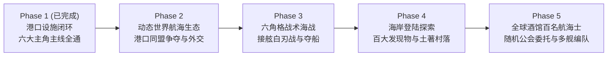

# 《大航海时代 II》(Uncharted Waters: New Horizons) 完整复刻蓝图与后续规划

> 更新日期：2026-10-13  
> 状态：**第一阶段（港口设施闭环 + 六大主角全线可玩）已完成**，进入第二至第五阶段深度沙盒与系统复刻。

---

## 一、项目愿景与架构原则

本项目致力于在现代浏览器中以 **SFC 16 色巅峰美术/合成音色 + 60fps 流畅画布 + 声明式叙事引擎** 完整复刻光荣 1994 年经典名作《大航海时代 II》（*Uncharted Waters: New Horizons*）。

核心工程原则：
1. **声明式剧情与状态机解耦**：所有主线与支线剧情均通过 `src/story/core/` 的强类型 `StoryArc` / `StoryEvent` / `StoryCondition` / `StoryEffect` 注册与校验，严禁在 UI 组件中硬编码剧情分支。
2. **中英双语零漏翻保证**：每次新增人物、港口对白、航行日志、战斗遭遇或系统提示，均由 `src/localization/localization.test.ts` 与 `npm run verify` 强制校验 100% 翻译覆盖。
3. **向后兼容的存档演进**：基于 `Save v7` 规范化迁移管线（`src/state/saveMigrations.ts`），后续扩展世界状态时保持旧存档无损升级。

---

## 二、第一阶段成果总结（已交付并合入 `master`）

### 1. 港口核心建筑功能闭环（消除占位小尾巴）
- **市场（Market）**：除常规买卖、行情查询外，实装 **商业投资（Invest）**，每次投入提升港口经济值（上限 1000）与累计投资额。
- **造船厂（Shipyard）**：实装 **工业投资（Invest）**（解锁更高级船型）、**建造新船（Build New）**（按港口工业度开放对应船型并自定义船名）、**改造火炮舱位（Remodel）**。
- **酒馆（Pub）**：实装 **解雇水手（Dismiss Crew）** 与 **请客喝酒（Treat）**（随机触发水手市场秘闻与港口投资情报）。
- **旅馆（Lodge）**：实装 **闲聊（Gossip）** 与 **港口情报（Port Info）**（实时汇总当前港口所属区域、经济、工业与价格指数）。
- **同业公会（Guild）**：实装 **国家势力情报（Country Info）**（统计六大海洋强国同盟港数量）。
- **王宫（Royal Palace）**：全新实装第 6 号建筑界面，支持 **觐见授勋（Audience & Rank Promotion）**（根据总名声与港口投资总额晋升侍从 → 骑士爵 → 勋爵 → 男爵 → 子爵 → 伯爵 → 侯爵 → 公爵）及 **申领王室远航补助（Request Subsidy）**。

### 2. 多主角引擎与六大主角全线可通关（M4 完成）
在约翰·法雷尔（M0–M3）完整路线基础上，完成了多主角状态隔离（`state.protagonistId`、按主角过滤 `resolveStoryEvent`、系统菜单一键切换主角开新档），并交付全部六位原作主角的完整主线、海战/决斗遭遇、专属航行日志、通关纪念铭牌与中英双语文本：

| 主角 ID | 中文名 / 英文名 | 出身港与初始资产 | 专属伙伴 | 主线章节 (`StoryArc`) 与核心流程 |
| :--- | :--- | :--- | :--- | :--- |
| `'joao'` | 约翰·法雷尔 (`João Franco`) | 里斯本 (`#1`) / 0 金 | 洛克 (`#32`)、恩里克 (`#33`)、多明戈 (`#34`) | `joao.lisbon-opening` → `first-voyage` → `conflict-and-growth` → `massawa` → `finale`（共 5 幕，寻找黄金乡与对抗马丁内斯） |
| `'katarina'` | 卡特琳娜·艾兰茨 (`Katarina Erantzo`) | 塞维尔 (`#2`) / 500 金 | 埃米利奥 (`#36`) | `katarina.vengeance`：塞维尔夺取“叛逆号” → 突破西班牙追击舰队 → 休达截击法雷尔舰队 → 马沙华揭开阴谋 → 开云决斗救埃米利奥 → 亚马逊击溃马丁内斯旗舰 → 塞维尔王宫特赦 |
| `'otto'` | 奥托·斯宾诺拉 (`Otto Baynes`) | 伦敦 (`#30`) / 1000 金 | 马修·罗伊 (`#37`) | `otto.armada`：伦敦王宫领受亨利八世私掠令与“老鹰号” → 潜入塞维尔船厂夺取西班牙大帆船 → 休达外海击败直布罗陀分舰队 → 圣多明尼各截击加勒比运宝船队 → 南特决战粉碎无敌舰队 → 伦敦王宫受封皇家海军最高统帅 |
| `'ernst'` | 恩斯特·洛佩斯 (`Ernst von Bohr`) | 阿姆斯特丹 (`#34`) / 800 金 | 汉斯 (`#38`)、劳拉 (`#39`) | `ernst.worldmap`：阿姆斯特丹接受墨卡托世界测绘委托与“金鹿号” → 里斯本招募六国语言翻译劳拉 → 发现好望角并赴马沙华公会整理南洋图页 → 发现马六甲海峡并击破东海海盗封锁 → 长崎寻获劳拉故乡 → 测绘亚马逊河口 → 返回阿姆斯特丹完成《世界地图集》 |
| `'pietro'` | 皮耶德·康迪 (`Pietro Conti`) | 热那亚 (`#9`) / 200 金（负债 5000） | 卡米洛 (`#35`) | `pietro.adventure`：热那亚启航 → 里斯本法雷尔宅邸受聘 → 测绘直布罗陀并调查亚力山卓酒馆 → 巴士拉决斗夺取圣者之杖 → 马沙华交接约翰获赠西洋海图 → 发现亚马逊河口并击败黄金乡守卫舰队 → 里斯本凯旋还清家族债务 |
| `'ali'` | 阿兰·维斯特 (`Ali Vezas`) | 伊斯坦堡 (`#3`) / 0 金（负债 1000） | 萨利姆 (`#40`) | `ali.merchant`：伊斯坦堡码头获萨利姆资助“胡格利号”与本金 → 亚力山卓香料贸易并获皮耶德线索 → 里斯本酒馆追寻妹妹萨莎足迹 → 亚丁护航击退红海劫掠者 → 巴士拉酒馆兄妹团聚 → 伊斯坦堡王宫获封帝国商业总顾问 |

---

## 三、后续阶段设想与完整复刻路线图（Phase 2 – Phase 5）

### Phase 2：动态世界航海生态与六国海权博弈（Dynamic World & Geopolitics）
1. **海上 AI 舰队巡航与交互（NPC Fleets Simulation）**
   - 激活 `src/data/fleetData.ts` 中的各国商船队、护航舰队、私掠舰队与海盗舰队，基于 `worldRoutePlanner` 在各大港口间按真实航线自主航行。
   - 海上视野内可主动点击或按键执行 **侦察（View）**、**交谈（Gossip）** 或 **开战（Battle）**。
2. **港口投资同盟度与国旗易帜（Allied Port Control）**
   - 将 `state.portInvestments` 扩展为六国阵营好感与港口占有率：当玩家在某港口的商业/工业投资累计达到阈值时，该港口在次月结算时改挂玩家所属国旗（或提升本国同盟港数量）。
   - 同盟港享受免税优惠、专属高级船型建造（如铁甲船、佛兰德大帆船、威尼斯炮舰）及王宫爵位加成。
3. **国家敌对度、私掠许可证与叛国/归顺机制（Diplomacy & Letters of Marque）**
   - 攻击他国舰队会降低对该国外交友好度；持有对应国家 `Marque`（私掠许可证）可在攻击敌对国船只时免受本国声望惩罚并获得海盗功勋。

### Phase 3：经典六角格战术海战与接舷夺船系统（Hex-Grid Tactical Naval Combat）
1. **多舰六角格海战棋盘（Hex Battle Map）**
   - 在现有四档距离旗舰海战（`src/combat/`）基础上，增设标准六角格战术沙盘模式：支持最多 10 艘敌我船只同场机动，受风向（8 方向）与风速（1–7 级）实时影响移动力。
2. **炮击类型、接舷白刃与单挑触发（Gunnery, Boarding & Duels）**
   - 支持船首炮/舷侧炮射界判定；两船邻接时可发起 **接舷战（Grapple / Rush）**，直接消耗双方水手，或触发敌我提督进入现有的 **三攻三防剑术单挑（Sword Duel）**。
3. **战利品缴获与俘获舰船编入（Prize Capture & Plunder）**
   - 击败敌方旗舰后可选择 **夺取船只（Capture Ship）**、**掠夺货物与金币（Plunder Cargo/Gold）** 或释放换取名声。

### Phase 4：海岸登陆探索、土著村落与 130+ 发现物全图鉴（Exploration & Discoveries）
1. **全大陆海岸搜索与村落互动（Landing & Village Exploration）**
   - 在世界地图任意海岸线支持 **登陆搜索（Search / Land）**，消耗水粮探索内陆河流与遗迹。
   - 发现土著村落（Village）后可执行 **友好款待（Entertain）** 提升亲密度，进而触发 **探索发现物（Explore）**。
2. **四大类发现物全图鉴与赞助商契约（Full Discovery Compendium & Patronage）**
   - 扩充 `src/data/discoveryData.ts`，完整收录历史遗迹、珍稀动植物、自然奇观与土著文物（A/B/C/D 四级稀有度）。
   - 在各国贵族宅邸（如里斯本公爵府、阿姆斯特丹墨卡托宅、热那亚贵族宅）支持签署 **探索赞助契约（Patronage Contract）**，预支探险经费并按发现物等级结算高额奖金与冒险名声。
3. **海上随机天灾与奇遇（Sea Hazards & Phenomena）**
   - 实装暴风雨（Storm）、无风带（Doldrums）、海草区（Sargasso）、坏血病（Scurvy，可用青柠汁 `Lime Juice` 解除）、鼠患（可用猫 `Cat` 或鼠药 `Rat Poison` 防治）与海怪/塞壬传闻。

### Phase 5：全球酒馆航海士招募、多舰物资调配与随机公会委托（Crew, Fleet & Procedural Quests）
1. **全球 90+ 历史航海士招募与忠诚度（Global Tavern Mate Recruitment）**
   - 将 `src/data/sailorData.ts` 扩展至原作完整航海士名录（含皮瑞·雷斯、安德烈·多利亚、但丁等名将），按游戏内时间与港口酒馆分布动态刷新，支持请客喝酒后招募入队。
2. **多舰船员/火炮/货舱精细编成（Multi-Ship Fleet Logistics）**
   - 在码头与海上舰队面板开放各分舰的独立水手分配、火炮过户、船首像（Figurehead）安装与副官自动贸易航线。
3. **同业公会与高利贷随机任务生成（Procedural Guild & Bank Contracts）**
   - 公会按月生成 **商品采买、信件速递、通缉海盗讨伐、催收欠款** 四类随机委托，完成后提升对应类型名声与王宫授勋进度；银行支持更高额度的信用贷款与定期计息。
